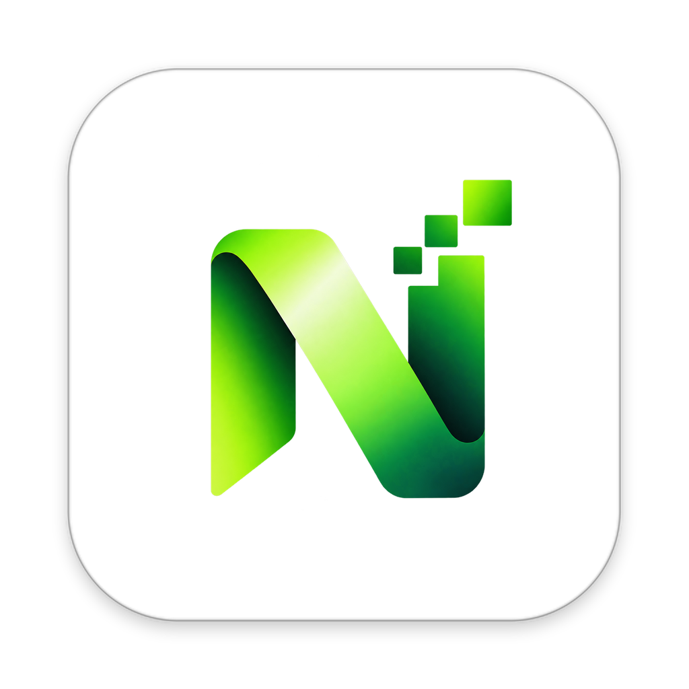

# CoreMind — AI-Native Desktop Development Environment

<p align="center">
  
</p>

<p align="center">
  <strong>An integrated, autonomous software engineering environment designed for macOS Apple Silicon.</strong><br />
  <em>Submitted to the Hackathon: Coding and Agentic Engineering Track (NVIDIA & Nebius AI Cloud).</em>
</p>

<p align="center">
  <a href="#1-hackathon-overview--mission">Hackathon Mission</a> •
  <a href="#2-system-architecture">Architecture</a> •
  <a href="#3-key-agentic-capabilities">Capabilities</a> •
  <a href="#4-prerequisites--system-requirements">Prerequisites</a> •
  <a href="#5-step-by-step-setup-guide">Setup Guide</a> •
  <a href="#6-running-the-end-to-end-demo">Demo Walkthrough</a> •
  <a href="#7-technology-stack">Tech Stack</a>
</p>

---

## 1. Hackathon Overview & Mission

### Track
**Coding and Agentic Engineering Track**

### The Problem
Modern software development tools treat AI as an external chatbot or a simple inline auto-complete popup. This approach suffers from three major flaws:
1. **Fragmented Workflow**: Developers constantly switch context between chat windows, terminal tabs, and file editors, copying and pasting code snippets manually.
2. **Lack of Grounded Verification**: AI generators propose code without testing it. If an edit introduces syntax errors, type mismatches, or broken unit tests, the burden of debugging falls entirely on the developer.
3. **Blind File Modifications**: Code changes spanning multiple services, routes, or tests are proposed in isolation, without holistic codebase dependency understanding or interactive diff inspection.

### The CoreMind Solution
**CoreMind** is an AI-native desktop IDE engineered specifically for **macOS Apple Silicon**. It seamlessly unites a high-performance Monaco code editor, native terminal execution, local symbol graph indexing, and an autonomous AI agentic loop:

```text
    USER TASK
        ↓
  1. ANALYZE   →  Parse repository symbols, active files, and AST relations
        ↓
  2. PLAN      →  Generate structured, dependency-aware Task Graph
        ↓
  3. IMPLEMENT →  Produce unified diffs across project files for user review
        ↓
  4. EXECUTE   →  Run commands and tests in integrated persistent terminal
        ↓
  5. VERIFY    →  Inspect terminal output, test results, and exit codes
        ↓
  6. SELF-HEAL →  If failure: analyze error trace → patch code → re-verify
        ↓
   COMPLETED
```

---

## 2. NVIDIA & Nebius Token Factory Integration

CoreMind uses open-source foundation models orchestrated through **Nebius Token Factory** and **Nebius AI Cloud**:
- **Primary Reasoning & Coding Model**: `nvidia/Nemotron-3-Ultra-550b-a55b` (NVIDIA Nemotron 3 Ultra, open weights). Other supported Nebius IDs: `nvidia/nemotron-3-super-120b-a12b`, `nvidia/Nemotron-3_5-Lightning`, `nvidia/NVIDIA-Nemotron-3-Nano-30B-A3B`. Requests go to `https://api.tokenfactory.nebius.com/v1`. A model name that is not on this list is rejected, not replaced.
- **Inference Orchestration**: High-throughput streaming via OpenAI-compatible endpoints hosted on Nebius Token Factory.
- **Architectural Separation**: The Electron desktop interface communicates over secure IPC and WebSocket/REST protocols with the local **CoreMind-AI-Backend** service (`FastAPI`), which manages prompt tokenization, context compression, tool dispatching, and agent execution.

---

## 3. System Architecture

```text
┌────────────────────────────────────────────────────────────────────────┐
│                        CoreMind Desktop IDE                            │
│                 (Electron 44 + React 18 + TypeScript)                  │
├────────────────────────────────┬───────────────────────────────────────┤
│ • Native macOS Window (Traffic │ • Multi-Tab Monaco Code Editor Core   │
│   lights, hiddenInset layout)  │ • Antigravity Activity & Phase Stream │
│ • Workspace File Tree & Sand-  │ • Interactive Diff & Approval Cards   │
│   boxed FileSystem Service     │ • Integrated xterm.js Native Terminal │
└────────────────────────────────┴───────────────────────────────────────┘
                                 │
                   Typed IPC & WebSocket Bridge
                                 ▼
┌────────────────────────────────────────────────────────────────────────┐
│                      CoreMind-AI-Backend                               │
│                         (FastAPI + Python)                             │
├────────────────────────────────┬───────────────────────────────────────┤
│ • TaskGraph & Execution Engine │ • Self-Healing Loop (Max 3 Repairs)   │
│ • Local RepoMap & AST Symbols  │ • Unified Diff Parser & Patcher       │
│ • Sandboxed Command Runner     │ • Git Pre-Edit Checkpoints & Rollback │
└────────────────────────────────┴───────────────────────────────────────┘
                                 │
                    HTTPS Streaming Inference
                                 ▼
┌────────────────────────────────────────────────────────────────────────┐
│             Nebius Token Factory / Nebius AI Cloud                     │
│                  NVIDIA Nemotron (70B Instruct)                        │
└────────────────────────────────────────────────────────────────────────┘
```

---

## 4. Key Agentic Capabilities

1. **Antigravity Activity Stream**:
   - Displays real-time agent phases (`ANALYZING`, `PLANNING`, `IMPLEMENTING`, `VERIFYING`, `SELF_HEALING`).
   - Collapsible thinking process, file discovery logs, and terminal execution telemetry.
2. **Interactive Plan & Approval Cards**:
   - Tasks are structured into explicit checklists before edits are applied.
   - Unified side-by-side diff previews with one-click **Approve & Apply** or **Reject** controls.
3. **Autonomous Self-Healing Loop**:
   - The agent executes tests (e.g. `pytest`, `vitest`, `npm test`) directly in the shell.
   - If tests fail, the engine captures stdout/stderr, extracts failure traces, devises a corrective patch, and runs verification again (up to 3 automated repair cycles).
4. **Workspace Path Protection**:
   - Path-traversal protection strictly confines all file reads, writes, and deletions to the active workspace folder.
   - Agent commands run in your local shell with your permissions. They are not sandboxed.
   - Pre-edit Git snapshotting allows instant one-click rollback if changes are undesirable.
5. **Native macOS Performance**:
   - Compiled for Apple Silicon (`arm64`), utilizing hardware acceleration and native window padding.

---

## 5. Prerequisites & System Requirements

- **Operating System**: macOS 12.0 (Monterey) or later (macOS 14 Sonoma / macOS 15 Sequoia recommended).
- **Architecture**: Apple Silicon (`arm64` — M1, M2, M3, M4).
- **Node.js**: `v20.x` or `v22.x` (LTS recommended).
- **Python**: `3.11` or `3.12` (for the AI Backend engine).
- **Package Managers**: `npm` (v9+) and `pip` (or `uv`).
- **Nebius Token Factory API Key**: Required for NVIDIA Nemotron model inference.
- **Backend JWT signing key**: `JWT_SECRET_KEY` in the backend `.env`, at least 32 characters. The backend has no default and will not start without it.

---

## 6. Step-by-Step Setup Guide

### Step 1: Clone Repositories

```bash
# Clone the CoreMind ecosystem
git clone https://github.com/NVIDIA-CoreMind/CoreMind-Application.git
git clone https://github.com/NVIDIA-CoreMind/CoreMind-AI-Backend.git
git clone https://github.com/NVIDIA-CoreMind/CoreMind.git
```

### Step 2: Configure & Start CoreMind AI Backend

```bash
cd CoreMind-AI-Backend

# Create and activate Python virtual environment
python3 -m venv .venv
source .venv/bin/activate

# Install dependencies
pip install -r requirements.txt

# Configure environment variables
cp .env.example .env
```

Edit `.env` to supply your credentials:
```env
NEBIUS_API_KEY=your_nebius_token_factory_key
NEBIUS_MODEL=nvidia/Nemotron-3-Ultra-550b-a55b
JWT_SECRET_KEY=replace-with-at-least-32-random-characters
COREMIND_BACKEND_PORT=43110
```

Start the backend server:
```bash
python3 main.py
# Server listens on http://127.0.0.1:43110 (loopback only) with WebSocket support at ws://127.0.0.1:43110/ws
```

### Step 3: Install & Launch CoreMind Desktop IDE

In a new terminal window:

```bash
cd CoreMind-Application

# Install dependencies
npm install

# Start in development mode with hot-reload
npm run dev
```

The CoreMind desktop application window will open immediately.

Sign in with Google in the app before using chat or agent features. The backend rejects HTTP requests and WebSocket connections that lack a valid session.

The app uses the hosted backend (`https://coremind-ai-backend.onrender.com`) by default. To develop against a local backend, override the URLs before starting Vite:

```bash
VITE_BACKEND_URL=http://127.0.0.1:43110 VITE_BACKEND_WS_URL=ws://127.0.0.1:43110/ws npm run dev
```

Opening the frontend in a regular browser shows the download page. Add `?ide=1` in development to preview the editor in a browser.

---

## 7. Running the End-to-End Demo

Follow this flow to demonstrate the full hackathon agentic workflow:

1. **Open Workspace**:
   - In CoreMind IDE, click **File → Open Folder** (`⌘ O`) and select any project directory (or a demo folder containing Python/TypeScript code and a test suite).
2. **Submit a Coding Task**:
   - Open the **AI Workspace** panel on the right (`⌘ L` or click the AI icon on the title bar).
   - Enter a software task in the prompt composer, for example:
     > *"Add token bucket rate-limiting middleware to `auth.ts`, write comprehensive unit tests in `rateLimiter.test.ts`, and run the test suite to verify."*
3. **Inspect the Agent Lifecycle**:
   - Observe the **Antigravity Activity Stream**:
     - **Phase 1: Analyzing**: Agent inspects codebase files and extracts AST signatures.
     - **Phase 2: Planning**: Agent generates a 4-step task checklist.
     - **Phase 3: Code Changes**: Diffs are rendered in the approval card.
4. **Approve Changes**:
   - Click **Approve & Apply Changes**. The files are updated instantly in the Monaco editor.
5. **Watch Autonomous Verification**:
   - The agent launches test commands in the integrated terminal.
   - Terminal logs stream live. If a test fails, the agent automatically diagnoses the stack trace, modifies the offending line, and re-executes tests until green.

---

## 8. Available Commands & Scripts

| Command | Description |
|---|---|
| `npm run dev` | Starts Vite dev server and launches Electron app with HMR |
| `npm run build` | Compiles TypeScript and builds production bundles |
| `npm run lint` | Runs ESLint over all TypeScript and TSX source files |
| `npm run typecheck` | Validates strict TypeScript compilation without emitting files |
| `npm run test` | Executes unit test suites using Vitest |
| `npm run package` | Builds standalone macOS `CoreMind.app` and `CoreMind.dmg` installer |

### Release Artifacts (macOS Apple Silicon)

- **Installer Binary**: `CoreMind-0.1.0-arm64.dmg` (162.1 MB)
- **SHA-256 Checksum**:
  ```text
  (Published with the final build. The checksum previously listed here did not match the built installer and was removed.)
  ```
- **Terminal Verification Command**:
  ```bash
  shasum -a 256 release/CoreMind-0.1.0-arm64.dmg
  ```

---

## 9. Technology Stack

- **Desktop Core**: [Electron 44](https://www.electronjs.org/) (Strict context isolation, zero node integration in renderer).
- **Editor Engine**: [Monaco Editor](https://microsoft.github.io/monaco-editor/) via `@monaco-editor/react`.
- **Frontend UI**: [React 18](https://react.dev/), [TypeScript 5](https://www.typescriptlang.org/), [Zustand 5](https://github.com/pmndrs/zustand).
- **Terminal Emulator**: [xterm.js](https://xtermjs.org/) & `xterm-addon-fit`.
- **AI Backend**: [FastAPI](https://fastapi.tiangolo.com/), Python 3.11, WebSocket streaming.
- **Model Provider**: [NVIDIA Nemotron 3 Ultra](https://huggingface.co/nvidia/NVIDIA-Nemotron-3-Ultra-550B-A55B-BF16) via [Nebius Token Factory](https://tokenfactory.nebius.com/).
- **Desktop Packager**: [electron-builder](https://www.electron.build/).

---

## 10. CoreMind Ecosystem Repositories

| Repository | Purpose | URL |
|---|---|---|
| **CoreMind-Application** | Desktop IDE (Electron + React + Monaco) | [GitHub](https://github.com/NVIDIA-CoreMind/CoreMind-Application) |
| **CoreMind-AI-Backend** | Agent Engine & NVIDIA Nemotron Bridge | [GitHub](https://github.com/NVIDIA-CoreMind/CoreMind-AI-Backend) |
| **CoreMind** | Official Marketing & Download Website | [GitHub](https://github.com/NVIDIA-CoreMind/CoreMind) / [coremind.dev](https://coremind.dev) |

---

## 11. Team & Authors

- **Manoj Sarya** ([@Manojarya0207](https://github.com/Manojarya0207)) — Desktop IDE Architecture, Electron/React Core & Agent UI
- **Pankaj Sarya** ([@pankajsarya](https://github.com/pankajsarya)) — AI Agent Engine, NVIDIA Nemotron Integration & Tooling
- **Yashas** ([@yashas1624](https://github.com/yashas1624)) — Product Engineering, UI/UX, Testing & Workflows

---

## 12. License

This project is open-source under the [MIT License](LICENSE).
